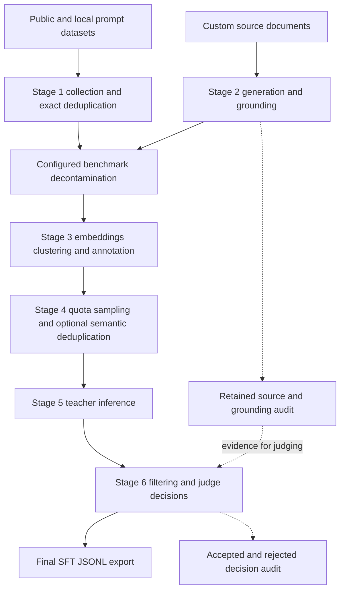

# SFT pipeline technical blog plan

**Status: proposal for review.** This is the outline and experiment plan, not the blog draft. No new experiments are scheduled by this document.

## The story

**Working title:** Building an SFT dataset with prompt curation and source grounding

The post should explain how we turn a heterogeneous prompt pool and custom documents into a controlled, inspectable training dataset. The central design question is how to spend a finite teacher-inference budget on useful examples, while retaining enough evidence to diagnose bad data and failed runs.

The intended reader is an ML engineer who understands SFT and model serving but wants a concrete system to adapt. Aim for roughly 3,000–4,000 words, with implementation details and full experiment settings linked from an appendix. Use one collected example and one generated example throughout, so readers can follow what each stage adds or removes.

Open with a real failure: a generated question asks about “the parish” without identifying it. The teacher supplies a plausible answer about the wrong context. Show how this motivates separate checks for identifying the subject, establishing an answer from the source, and judging the teacher's actual response. Then introduce the complete pipeline.

Describe “high quality” in measurable terms: answerability, correctness, instruction following, coverage, limited redundancy, and usefulness to a trained student. A successful run establishes that the stages work together; downstream training and independent content evaluation establish different claims.

## Proposed outline

| Section | What the reader should understand | How we will explain it |
| --- | --- | --- |
| 1. The dataset we want to build | Why collecting more prompts is insufficient; what the inference budget and target mix constrain | The failure example, a short list of dataset objectives, and the final record schema |
| 2. The complete data flow | Two input routes converge before selection and response generation | One architecture diagram with stage inputs and outputs; preserve the repository's stage names and show decontamination in its actual position |
| 3. Curating existing prompts | Source adapters, conversation extraction, provenance, exact deduplication, and preserving code formatting | Follow one record from its source to its normalized prompt and stable ID; distinguish exact deduplication from semantic similarity and benchmark overlap |
| 4. Generating prompts from custom sources | Chunking, generation, abstention, source-blind context checks, and source answerability | Follow a source passage through an accepted and rejected question. Show that the teacher sees a standalone question, while validators retain the passage, proposed reference and evidence quote |
| 5. Choosing which prompts deserve inference | Embeddings, clustering, domain/difficulty annotations, quota cells, and selection across clusters | A domain-by-difficulty table and a cluster-selection illustration. Explain representative-first selection, subsequent peripheral candidates, quota shortages, and optional semantic deduplication, which defaults to false |
| 6. Generating responses at different scales | The tested OpenAI-compatible API path, reasoning/final-answer parsing, retries, and token-limit handling | A small request/response example. Show the external dispatcher route as a separate integration pattern: export requests with stable IDs, infer elsewhere, then join answers back. Identify the required data contract without implying a turnkey adapter exists |
| 7. Filtering and inspecting the result | What structural checks, heuristics, Docker execution and the judge actually establish | A filter table plus one decision audit. Explain full-text judging, evidence before scores, candidate/reference separation, and why a runnable snippet is not proof of task correctness |
| 8. Running without manual handoffs | Shards, DuckDB checkpoints, retry behavior, output publication, and automatic export | A compact interruption/resume timeline and a table of tested failure modes. Separate a no-work resume from recovery after a process dies |
| 9. Measuring whether the pipeline helps | Reliability, content quality, selection effects, downstream usefulness and cost | The experiments below, with controlled baselines and uncertainty. Keep medium-run results and newer grounding results attached to their respective code versions |
| 10. Reproducing and extending the pipeline | How a reader starts small, changes a source or teacher, and knows which limits remain | Link the validated config and concise run instructions. Close with measured limitations and the extensions actually supported by the code |

Keep code excerpts short: the final schema, a configuration excerpt, and possibly sampling pseudocode. Use the implementation to explain decisions rather than narrating every class or function. Distinguish clustering from the subsequent annotation step; an embedding neighborhood is not itself a verified domain or difficulty label.

## Visuals and tables

The first diagram should have this shape; this is a topology sketch, not finished artwork:

| Asset | Purpose and presentation |
| --- | --- |
| Architecture diagram | Orient readers once, with clear boundaries between training fields, evidence metadata and inference services |
| Record walkthrough | A small table showing which fields appear at each stage and which are dropped at export; include the source/reference boundary explicitly |
| Grounding example | Passage, underspecified question, corrected question, and checker decisions side by side. Show a false rejection too, so the tradeoff is visible |
| Selection illustration | A conceptual cluster sketch and target-versus-achieved quota heatmaps. Label the sketch as illustrative; do not treat a 2D embedding plot as evidence of diversity |
| Retention chart | Show collected and generated inputs merging, followed by stage counts and mutually exclusive rejection reasons. Use one frozen run throughout |
| Quality and cost figures | Error rates with uncertainty, retained useful examples per inference budget, and downstream scores at equal training-token budgets |
| Recovery timeline | Mark durable output, interruption and retry; tie each claimed guarantee to the tested boundary |

Keep the main post to about five substantial figures and two or three tables; combine related panels. Use Mermaid or SVG for diagrams and standard plotting tools for reproducible SVG/PNG charts. Static figures are sufficient for the main post; link an optional inspection UI only if it adds useful record-level exploration. Avoid decorative generated images.

## Evidence already available

These are results we can cite with their limits, not interchangeable measurements of the current pipeline.

| Evidence | What it supports | What it does not establish |
| --- | --- | --- |
| [Medium run](../smoke/freeze-validation.md): 9,924 collected prompts, 1,002 generated prompts, 3,805 inferences, 3,131 exports in 51 minutes 14 seconds | An unattended HTTP workflow at this tested size; measured stage costs and retention | The run predates the latest grounding/judge changes and is not a final-version quality benchmark |
| [Latest validation](../smoke/grounding-validation.md): 20 inferences, 18 exports, four generated examples in the export, unchanged-output resume | Integration of the current grounding path, GPU work, Docker and export | A representative estimate of dataset quality or production throughput |
| Same-pool semantic dedup comparison: 39 above-threshold selected pairs with dedup off, zero with it on, at cosine 0.92 | The configured cosine constraint works on that pool | Semantic equivalence, better student learning, or scalability to millions of prompts |
| Latest judge comparison: 15/16 fresh held-out decisions correct with both models; 8B baseline 13/16 | A small diagnostic comparison with assistant-curated labels | Human-validated accuracy or a reliable production error rate |
| Grounding checks: 7/7 original cases; fresh checks 7/8 with 8B and 6/8 with 32B | A specific failure was fixed and false rejections remain | That source grounding or proposed references are always correct |
| 288 passing full-suite tests, focused audit tests, and earlier Stage 3/4/5 interruption probes | Tested integration, isolation behavior and particular recovery boundaries | Universal crash recovery, clean installation, or arbitrary-code security guarantees |

The [medium-run content audit](../smoke/audit-findings.md) and [latest answer inspection](../smoke/grounding-quality-findings.md) supply useful failure examples. Preserve the distinction between model review, assistant inspection and human labels. Do not turn reviewer agreement into a correctness percentage.

## Experiments to support the post

The [experiment proposals](EXPERIMENTS.md) specify controls, approximate starting sizes, labeling and measurement. The main questions are:

| Experiment | Comparison | Evidence it adds |
| --- | --- | --- |
| 1. Current medium run | Final code on approximately the earlier 10,000-prompt workload, plus resume/interruption checks | Reliability, stage costs and a current retention chart |
| 2. Grounding quality | Generation prompts and grounding policies on matched source chunks/candidates, with independent human review | Valid-question yield, retained precision, false rejections and reference errors |
| 3. Judge calibration | Old/current judge against human labels, with a locked evaluation split | Accepted-answer quality versus coverage, with uncertainty and domain breakdowns |
| 4. Student training | Random selection, cluster/quota selection, full filtering, and added grounded generation at equal training-token budgets | Whether the resulting data improves learning and which components contribute |
| 5. Sampling and deduplication | Random versus cluster/quota sampling, then optional deduplication on the same pool | Coverage, redundancy, quota shortfalls and selection cost |

For student training, first pilot the simplest and full-pipeline datasets. The fuller proposal is four dataset arms × three paired seeds, plus evaluation of the original student. This is the expensive experiment and needs an explicit resource decision. Smaller studies can establish content quality without claiming better downstream learning.

## Recommended scope and sequence

For an engineering release post, run experiments 1–3 and the inexpensive reuse-based comparison in 5. That supports a concrete account of execution, measured content tradeoffs and selection behavior.

For a post claiming **better SFT training data**, add experiment 4. My preferred sequence is to establish the independent labels and current medium run first, then conduct the student pilot before committing to all 12 training runs. The pilot determines feasibility, not the final winning model or cherry-picked evaluation.

A very large generation run alone will not resolve the current quality questions. Defer multi-million-record throughput claims, scaling comparisons with the external dispatcher, and broad student-size sweeps unless we decide they are central to the article.

After approval, keep prose and figure assets in `blog/`; keep experiment configurations, code, logs and results under `smoke/`. Generate plotted data from those result files, with commit/config/model/source identifiers recorded. No new Slurm work is authorized by this plan; the earlier `hissu` exception was for one run only.

## Boundaries for the final article

Keep unsupported features out of the main promise: multilingual expansion, KV-cache-aware ordering, complete offline/distributed inference validation, automatic cache invalidation after config changes, and clean-install portability. Describe the external dispatcher as our large-run workflow suggestion, with manual integration boundaries identified. Source licensing and attribution need review before publishing excerpts or dataset records; a code release does not automatically authorize redistributing every input.

The approval decision is the article's scope: an engineering release with independently measured content quality, or that release plus the controlled student-training comparison. The working recommendation is the latter if training and review resources permit.
