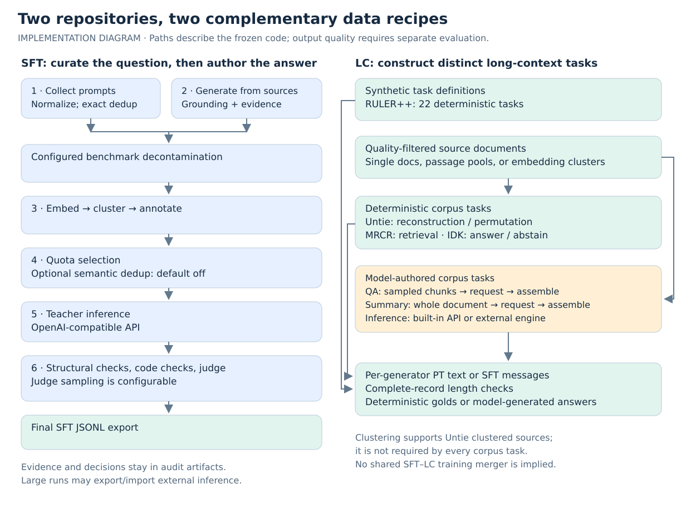
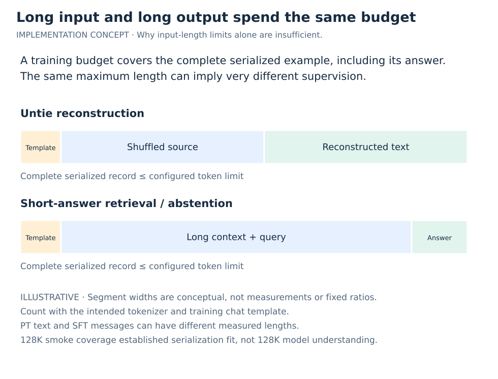
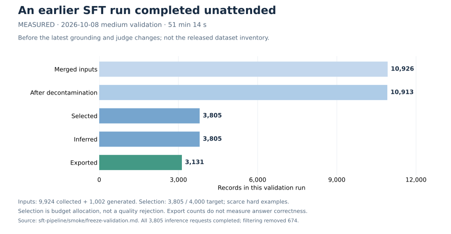
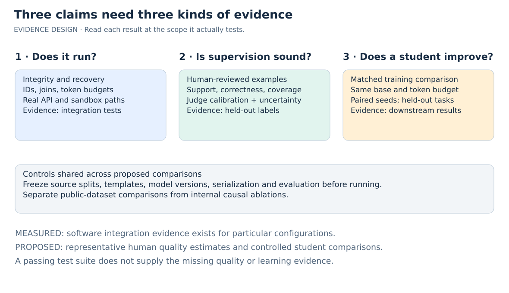
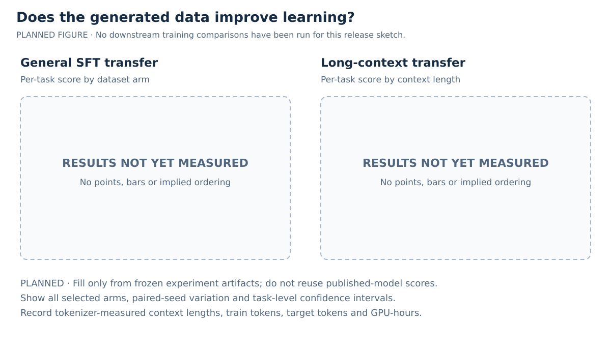

# From prompts to long-context tasks: releasing two data pipelines

*An inspectable path from public prompts and source documents to instruction-tuning and long-context training data.*

> **Editorial sketch — 14 October 2026.** Announcement copy below is for the planned release. `[TODO]` marks missing publication details; `[EXPERIMENT]` marks proposed measurements. Code descriptions reflect the frozen working trees. Recorded validation results are identified separately from the datasets being released.

Today we’re releasing [**sft-pipeline**](https://github.com/rahul-amd/sft-pipeline) and [**lc-pipeline**](https://github.com/rahul-amd/lc-pipeline), together with **[TODO: SFT dataset name and download link]** and **[TODO: long-context dataset name and download link]**. The repositories expose the decisions behind the data: which prompts to select, how to turn documents into questions, which teacher responses to retain, and how to construct examples that require models to use long contexts.

These decisions are easy to hide inside a final JSONL file. A fluent answer can be wrong. A large collection can contain many versions of the same exercise. A 32K-token example can ask a question answered by its first sentence. Our aim is to make those failure modes visible and give others practical controls for building and testing their own recipes.

The two pipelines address different parts of the problem. SFT separates prompt curation from teacher-answer generation, so we can allocate inference across a deliberate mixture. LC constructs tasks around retrieval, aggregation, ordering, abstention, document QA, and summarization, with explicit accounting for the complete training sequence. Together they offer reusable ingredients for post-training; choosing a joint mixture and demonstrating its learning value are separate experiments.

## What we are releasing

| Artifact | What it contains | Publication details to fill |
|---|---|---|
| `sft-pipeline` | Collection, grounded prompt generation, configured benchmark decontamination, clustering/selection, teacher inference, filtering, and audit artifacts | [TODO: immutable release tag, minimal recipe, environment instructions] |
| SFT dataset | Selected prompts with teacher reasoning/answers and compact provenance fields | [TODO: name, URL/revision, records, serialized/target tokens, mixture, terms] |
| `lc-pipeline` | Deterministic synthetic tasks, corpus transformations, model-authored document tasks, and PT/SFT serialization | [TODO: immutable release tag, recipes, environment instructions] |
| Long-context dataset | [TODO: selected task families, formats, and observed context-length distribution] | [TODO: name, URL/revision, records by family, token counts, terms] |

The data cards should identify the exact generation revision and recipe, even if a dataset was produced before the current code improvements. They should also describe source splits, teacher models, tokenizer/template settings, and component permissions. The [release-manifest template](release-manifest.template.yaml) collects these details. The validation counts later in this article are small-run engineering evidence, not the sizes of these release artifacts.

*Figure 1. The two data-production paths. SFT exports prompt/reasoning/answer records; LC generators export PT text or SFT messages. The diagram does not imply a shared training orchestrator. [PNG preview](figures/pipeline-overview.png).*

## SFT: spend the teacher budget on a deliberate prompt mixture

The SFT pipeline separates deciding **what to ask** from generating **how to answer**. Public instruction collections supply an initial prompt pool. Custom documents supply additional, source-derived questions. Embeddings, annotations and quotas select a mixture before teacher inference consumes most of the generation budget. Response filters then remove identifiable failures and preserve decisions for inspection.

There are six numbered stages, with benchmark decontamination between Stages 2 and 3 and final export after Stage 6. The intermediate records matter: a final answer alone cannot explain whether a problem came from its source, question, teacher response or filter.

### Two ways to build the prompt pool

Stage 1 reads Hugging Face datasets and local JSONL. A configured field can hold a plain instruction or an OpenAI/ShareGPT conversation. For a conversation, collection takes the first user turn and prepends a preceding system message when present. Existing assistant responses are not used as teacher targets. This is a single-prompt extraction workflow; sources whose questions depend on separate context fields should first be adapted into complete prompts.

Collection normalizes line endings while preserving indentation, line breaks and Unicode literals. It hashes the resulting text for identity and removes repeated IDs. This deliberately conservative normalization matters for code: changing whitespace can change the program. It also makes exact deduplication a limited claim. Two paraphrases, or two differently formatted versions of the same exercise, can remain distinct. Later prompt selection has a separate, optional semantic constraint.

Stage 2 generates questions from local or Hugging Face source documents. Documents are split into overlapping chunks, normally with token-aware splitting; a character-based fallback is available when the splitter dependencies are absent. A generator is asked for diverse, standalone questions whose answers follow from the chunk. It can return fewer questions than requested, including an empty array when the material is unsuitable.

“Standalone” and “supported by the source” are different requirements. A question about “the parish” can be answerable to a validator reading the passage while leaving the eventual student without an identified subject. The pipeline therefore performs two checks when grounding is enabled, which is the default:

1. A source-blind check sees one question at a time and decides whether its subject and necessary context are identified. Other questions cannot accidentally supply the missing information.
2. A source-visible check assesses answerability, proposes a reference answer and returns an exact evidence quote.

A question survives only when both judgments pass, the reference and quote are nonempty, and the quote is a substring of the source. Each evaluated chunk gets an audit containing accepted and rejected candidates. Malformed or incomplete verdicts trigger retry/failure rather than silently becoming rejected examples.

The quote check proves where the quote came from. It does not prove that the quote entails the proposed answer, or that a calculation is correct. Both semantic checks still depend on a model. The accepted record retains `source_context`, `reference_answer` and `grounding` so these decisions can be inspected later. Teacher inference receives the standalone question; filtering can consult the retained evidence separately.

### Remove configured benchmark overlaps before selection

The merged pool next passes through optional benchmark decontamination. Placing this before embedding and teacher inference avoids spending those resources on prompts already identified as overlapping an evaluation set.

The index uses normalized contiguous word spans from explicitly configured benchmark fields. Defaults are 13-word spans, with whole-item matching for shorter items of at least five words. Matching uses a separate normalization that lowercases and removes punctuation; it never rewrites the training prompt. Removed IDs, matched benchmarks and spans are logged. Requested benchmark subsets must load successfully and contain usable text.

This is protection against a specified form of textual overlap. It does not establish absence of paraphrased contamination, teacher-model pretraining exposure or overlap with unconfigured evaluations. No benchmarks are loaded by the default empty evaluation list. The example collection config includes MMLU and HumanEval test sources, making the final release recipe's source/split inventory and benchmark exclusions especially important. Whitespace tokenization also limits partial-overlap detection in scripts without spaces.

### Select across domains, difficulty levels and clusters

Stage 3 embeds prompts using Sentence Transformers, stores normalized vectors in sharded Parquet, builds a FAISS index and assigns clusters. Several clustering backends are configurable. The current embedding implementation keeps the last 512 model tokens to limit memory and retain task-specific endings after boilerplate. That is an explicit coverage tradeoff for long prompts.

Domain and difficulty labels initially come from heuristics. Optional API annotation supplies validated domain, topic, difficulty and language fields, with model labels taking precedence. Clusters describe embedding neighborhoods; annotations describe requested categories. Neither constitutes proof that an exercise is hard or educationally useful. Annotation also uses a bounded tail of long prompts, so it can miss constraints appearing earlier.

Stage 4 turns the annotated pool into a teacher workload. Configuration sets a total prompt target, domain fractions and per-domain difficulty fractions. Within each domain/difficulty cell, it groups examples by cluster, takes each cluster's most central representative first, and then works from the periphery inward while visiting clusters round-robin. This expresses a useful selection hypothesis: cover distinct neighborhoods before repeatedly drawing from a large, repetitive one. Whether it improves student learning remains an experiment.

Semantic deduplication is **off by default**. When enabled, normalized-vector cosine checks reject candidates too similar to anything already selected, including selections from other clusters and quota cells. Replacement candidates come from the same cell. Scarce cells and integer rounding can leave the output below target; the sampler reports shortfalls and does not silently redistribute the budget.

An earlier same-pool comparison illustrates the constraint rather than downstream value: the selected set contained 39 pairs above cosine 0.92 with semantic deduplication off and zero with it on. Both settings selected 3,805 examples against a 4,000 target. This does not show that all rejected pairs were interchangeable or that removing them improves training.

### Generate responses through a replaceable inference boundary

Stage 5 supports an OpenAI-compatible HTTP endpoint and offline vLLM execution. The HTTP path bounds concurrent requests, stores completions as they arrive and checkpoints durable output. It keeps the finish reason and model identifier. If the server separates reasoning from final content, those fields are preserved; otherwise Stage 6 parses configured delimiters and then heuristic fallbacks.

The pipeline sends a user message containing the prompt and lets the teacher use its native response format. A nonempty answer and a reliably separable reasoning field therefore depend on the teacher and serving configuration. Multiple HTTP candidates use a simple length-based choice among eligible completions, not a learned correctness ranking.

For a larger production run, we previously exported prompts to JSONL, used a separate dispatcher to scale inference, and brought responses back for filtering. That is a useful integration pattern to document alongside the release, with stable IDs and a response-field contract. It remains an external handoff; it should not be presented as an automatic dispatcher integration. The unattended validation used the built-in HTTP path.

### Filter identifiable defects and keep the decisions

Stage 6 applies structural checks, heuristics, domain-specific code checks and an optional sampled model judge, in that order.

Structural checks reject token-limited completions, missing fields, responses outside configured approximate length bounds and repetition loops. Heuristics screen low lexical variety and narrow boilerplate nonanswers. These checks identify symptoms, not factual correctness. There is no mathematical correctness filter.

For configured code domains, the checker considers the last explicitly tagged Python block. The default execution backend uses a disposable Docker container with no network, no host data mounts, a read-only root filesystem, an unprivileged user, dropped capabilities and CPU, memory, process and time limits. Docker/image infrastructure is trusted and containers share the host kernel. Passing means the executed snippet did not reveal a rejected defect; a function that is only defined may never be called. Some fragments and environment-related failures pass with uncertainty reasons. This is not task-level testing against a specification.

The judge receives the complete candidate question, reasoning and answer, plus separate source/reference fields when available. Its rubric asks it to establish the expected behavior, compare the actual candidate and assess any reference independently before assigning a verdict. An ambiguous question, an incorrect or uncertain verdict, or a score below threshold causes rejection. Oversized judge inputs fail instead of being silently clipped, and infrastructure errors raise by default.

Judging is sampled: the configuration default is 10%, although the latest integration run used 100%. An exported example is therefore not necessarily judged. The decision audit distinguishes judged, not sampled, disabled, not reached and error states, and records both acceptance and rejection outcomes.

### Follow one illustrative record

Consider this invented source sentence: “At the Halcyon test facility, Pump A moved 240 liters in 6 minutes.” A generated question might be: “What was Pump A's average flow rate at the Halcyon test facility, given that it moved 240 liters in 6 minutes?” This example illustrates the record flow; it is not an observed release example.

| Boundary | What the record carries |
| --- | --- |
| Generation and grounding | Question, content ID, source/chunk identifiers, original sentence, proposed reference of 40 liters/minute, evidence and verdicts |
| Decontamination | Survives only if it does not match the configured benchmark index |
| Clustering and selection | Domain/difficulty labels, cluster assignment and centroid similarity; selection depends on the configured cell quota |
| Teacher inference | The question alone is sent; the response adds teacher identifier, completion status and response fields |
| Filtering | Structural/heuristic results and any judge decision; source and reference remain distinct from the teacher's answer |
| Final export | `id`, `prompt`, `reasoning`, `answer`, `domain`, `difficulty`, `language`, `source`, `teacher_model` |

Final export checks unique IDs and nonempty prompt/reasoning/answer fields. Rich grounding and judge metadata remain in intermediate artifacts rather than the compact training schema. The release should link these audits and source manifests where redistribution permits them.

### Keep intermediate artifacts usable

DuckDB tracks stages/items while sharded files hold outputs; stage-specific ledgers and recovery logic support resuming interrupted work. Output is written before completion is recorded. Resume assumes unchanged inputs, configuration, and model endpoints, so changed experiments need fresh run IDs. Publication is not a single transaction across every shard.

The compact export also needs a declared training serialization: decide how `reasoning` and `answer` become assistant content and which tokens receive loss. The repository’s final record schema is not itself a complete trainer configuration.

*[Implementation references and detailed claim checks](sections/sft-fact-check.md).*

## Long-context data: specify what the model must do with the context

A long training sequence is useful only if its task requires the model to use that sequence. `lc-pipeline` builds a mix of tasks with different demands: retrieve a precise passage, aggregate scattered records, follow a graph, recover paragraph order, abstain when a fact is missing, answer questions about a document, and summarize it. These tasks give us explicit controls over the operation, context length, source material, and answer format.

The implementation has two main branches. Deterministic generators construct problems and compute their answers directly. Corpus-based generators transform real documents, either with a known target or with a model-generated answer. Clustering is an optional preparation step for assembling longer sources; it is not a requirement for every task.

### One training interface, with explicit length accounting

Each family supports two trainable representations. PT mode writes a flat `text` field containing the task and answer. SFT mode writes a `messages` array with user and assistant turns. The surrounding metadata varies by task: synthetic examples retain structured golds; document QA retains its question–answer pairs and source identity. This is a shared training interface, rather than an identical metadata schema for every generator. Training loss masking remains a trainer-side choice.

The budget applies to the **complete serialized training example**, including the answer. That distinction matters when the answer can be a long paragraph list or an entire reconstructed document. With a Hugging Face tokenizer that provides a chat template, SFT length includes the template's role markers and other tokens. PT length counts the actual text. When no chat template is available, SFT counting uses newline-joined message content; `length_mode` records that weaker contract. The explicit `whitespace` tokenizer counts word/punctuation chunks and is an approximation, not a model-token guarantee. A requested tokenizer that fails to load causes an error rather than a silent substitution.

For synthetic tasks, the driver probes a task-specific size parameter, searches for a suitable size, then checks each completed example and shrinks it if necessary. Impossible minimum-size examples fail. Outputs record `training_length`, and content/settings-based identifiers distinguish examples across seeds, formats, and budgets. Final JSONL publication uses temporary files followed by replacement, so interrupted generation does not publish a partially written final file.

*Figure 2. The answer consumes sequence space too. Segment widths are illustrative, not measured proportions. A tokenizer/template-aware cap applies to the complete serialized example. [PNG preview](figures/context-budget.png).*

### Real documents, traceable selection, and optional clustering

The shared corpus reader streams Parquet batches and recognizes common text and identifier column names independently for each shard. Where metadata exists, it can filter short documents, low mean education scores, and records marked as near-duplicates. These are source-selection rules, not fresh quality judgments: missing education fields are not scored, and the near-duplicate rule drops all records whose supplied cluster size exceeds one. It does not select a representative from each duplicate group.

Source tags retain the relative shard path and absolute row offset. Those tags also serve as fallback document IDs when an explicit ID is absent. Cluster joins fail if documents are missing or their IDs are duplicated, which prevents a seemingly successful example from silently losing part of its source.

For sources too short to fill the intended window, clustering provides a way to assemble related documents. The default embedding model is `Qwen/Qwen3-Embedding-0.6B`; it embeds a configurable prefix, **256 tokens by default**. Normalized embeddings feed an exact top-*k* neighbor search implemented with batched GPU matrix multiplication. A greedy single-linkage procedure grows clusters through sufficiently similar neighbors while respecting a token budget. Embeddings and document metadata can be cached for reclustering.

This trades semantic coverage for practical embedding cost. Prefix similarity can miss later topic changes. Single linkage allows a document to join through one member, so membership does not imply that every document pair is similar. Cluster budgets use source token-count metadata; downstream generators enforce their own selected tokenizer's final limit. Exact neighbor search is quadratic, which also bounds how far this implementation should be scaled unchanged.

### Deterministic tasks: diverse operations with inspectable golds

The synthetic registry contains **22 task types**, organized around operations rather than one generic retrieval template:

| Operation group | Task types | What the target requires |
|---|---|---|
| Words, counts, and sets | Common words, frequent words, occurrence count, predicate count, distinct count, top-*k*, set operations | Collect evidence across lists; distinguish multiplicity from membership |
| Records and arithmetic | Category tally, numeric aggregation, group-by, variable arithmetic | Aggregate records or evaluate assignments rather than copy one local span |
| State tracking | Variable tracking | Follow assignment chains to recover the requested value |
| Graph operations | BFS layers, parents, children, descendants, ancestors, shortest path, reachability, cycle detection, component size, maximum degree | Compute a specified property of a rendered directed graph |

Some task types sample among operations: numeric aggregation includes sum, minimum, maximum, mean, and median; set operations include intersection, union size, and difference. Golds are computed from the generated structures, and independent verification can recompute them from the rendered contexts. Optional few-shot examples share the same total budget. Seeded per-example generation permits parallel construction without making worker scheduling part of the data definition.

These tasks provide controllable supervision, not evidence of general long-context competence by themselves. Their contribution to a trained model needs evaluation on held-out tasks and sources, with explicit separation from benchmark examples.

### Three corpus transformations with known targets

**Untie** splits source text into units, samples a contiguous span, shuffles the units, and attaches display labels. Reconstruction asks for the text in source order; permutation asks only for the label sequence. Both can use a single document or a concatenation of cluster members. Reconstruction spends much of the window twice—once in the shuffled input and once in the answer—so fitting must account for both. Permutation offers a shorter target for a similar ordering exercise.

For an illustrative three-unit example, the display might contain `[1] Results`, `[2] Introduction`, `[3] Methods`; the source-order target is `2, 3, 1`. Actual units contain prose rather than these section labels. The limitation is semantic ambiguity: independent paragraphs may admit several reasonable orders, and cluster rank is a construction order rather than an objectively correct discourse order. We therefore treat source-order recovery as a training hypothesis to test, particularly for clustered sources.

**MRCR** builds passage-retrieval problems using exactly two queried markers. One passage carries both markers positively. Distractors carry only one, explicitly negate the other, or contain unrelated markers. The answer must start with a random string and then reproduce the selected passage verbatim. This combines conjunction, negation, precise copying, and a small instruction-following requirement.

An illustrative query asks for the paragraph marked as both *car* and *lemon*. A paragraph marked *car, but not lemon* is a deliberate near miss. The current implementation fixes the conjunction at two markers; it does not support arbitrary-*k* retrieval.

**IDK** adds randomized attribute–item–code bindings to passages and asks a multiple-choice question. It samples three cases: the requested binding exists; the requested item has no generated binding; or it has a binding for a different attribute. The last case plants a plausible but incorrect answer among the options.

For example, “The access code for the lantern is `7F3A-21`” does not answer a question about the lantern's *security* code. The correct choice is “I don't know.” Randomized codes remove the need for external factual knowledge, while explicit bindings make the intended answer checkable. Whether this supervision improves abstention on natural documents remains an evaluation question.

### Model-authored document tasks, with inference as a replaceable step

Multi-hop QA and summarization share a three-phase workflow: **prepare, infer, assemble**. Preparation writes source documents, messages, and stable request IDs to JSONL. A manifest records the tokenizer, optional final length cap, counts, and hashes of the prepared files. This boundary allows the same requests to run through the built-in OpenAI-compatible API client or an external dispatcher.

For QA, preparation splits a document into measured chunks while retaining internal line breaks. By default, each authoring request receives three or four sampled chunks and asks for one question whose answer requires information from all of them. The model can return `cannot generate` when the chunks do not support that request. Assembly attaches accepted pairs to the **full original document**: PT appends question–answer text; SFT presents the document and numbered questions with corresponding assistant answers. Repeated normalized questions within a document are removed, keeping the first answer. This is duplicate suppression, not selection of the best answer.

Summarization supplies the full document to the authoring model, asks for faithful coverage beyond its opening sections, and optionally requests an approximate word count. Final examples retain the document, instruction, and summary in the selected training representation.

Assembly checks the prepared hashes and joins responses by request ID. Unknown or duplicate IDs fail; missing responses require an explicit partial-import option. Explicit transport failures, truncated completions, malformed QA, and empty summaries also fail. External responses that omit completion metadata cannot prove whether generation finished normally. Usable rows must fit the configured final cap, and an empty final dataset is not published as success. Reports expose missing responses, QA abstentions, and duplicate removal.

The built-in client provides bounded concurrency and transient-error retries for small unattended runs. Large inference can use a dispatcher while preserving the request IDs and response metadata needed by assembly. Neither route supplies a factual-quality guarantee.

*[Implementation references and detailed claim checks](sections/lc-fact-check.md).*

## What we have validated so far

We exercised real execution paths before writing this post: GPU embeddings, OpenAI-compatible inference, Docker-based SFT code checks, LC format/length contracts, and unattended orchestration. The recorded results belong to particular configurations and revisions:

| Validation | Recorded result | Scope |
|---|---|---|
| Latest SFT grounding/judge work | 288 regression tests passed; 20 HTTP completions produced 18 exports in 223 seconds, including four source-generated examples | Small integration run; both excluded completions hit the token limit |
| Earlier SFT medium run | 10,926 merged prompts; 3,805 selected/inferred; 3,131 exported in 51 minutes 14 seconds | Predates the latest grounding/judge changes; selection target was 4,000 |
| LC integration matrix | 108 regression tests; 278 output rows across 123 files and 41 matrix commands | Covered all families, PT/SFT, GPU embeddings, and real API generation; some rows are alternate formats of the same cases |
| LC final shell orchestration | 36 output rows and 14 API responses | Separate unattended run after the QA duplicate-handling correction |
| LC long-sequence fitting | Three synthetic task types at a 128K cap; maximum measured training length 131,054 tokens | Serialization/generation coverage, not 128K model inference |

*Figure 3. Retention in the earlier unattended medium run. Inputs were 9,924 collected and 1,002 generated prompts. Selection allocates a budget; it is not a quality-rejection rate. The final 674 removals came during filtering. These are historical validation counts, not release inventory. [CSV](figures/sft-medium-retention.csv) · [PNG](figures/sft-medium-retention.png).*

Recovery checks included no-work resumes that preserved output hashes and specific SFT interruption/retry probes. The LC matrix checked identifiers, deterministic targets, reconstruction, and complete training lengths. Real LC authoring requests used documents of roughly 3K–14K tokens. The runs reused existing compute environments; they do not certify a clean installation or every possible configuration. [Recorded evidence and source-report identities](references/CLAIMS.md).

Content inspection still found failures that software checks cannot settle. SFT answers included overstatements accepted by a model judge. One LC answer changed a source date from September 2022 to June 2022; some questions labeled “multi-hop” merely combined independent facts. These findings motivate the next evaluation layer: representative review and controlled student training. They also help define what to label—support, correctness, completeness, and evidence dependence—rather than treating fluency or judge agreement as quality.

[TODO: attach selected, redistributable validation reports to the public release and replace internal evidence references with stable public artifact URLs.]

## What would demonstrate that the data helps?

A completed pipeline run establishes that requests, artifacts and training records fit together. It does not establish that its answers are correct or that training on them improves a model. Our release evaluation should make those claims separately: software integrity, content quality and downstream usefulness. **The comparisons below are proposed experiments; their results are placeholders.**

*Figure 4. Software behavior, supervision quality, and learning value require different evidence. Representative human estimates and controlled student comparisons remain proposed. [PNG preview](figures/evaluation-design.png).*

### Compare datasets within the capability they target

For broad instruction tuning, start with [Tülu 3's SFT mixture](https://huggingface.co/datasets/allenai/tulu-3-sft-mixture) and [SmolTalk](https://huggingface.co/datasets/HuggingFaceTB/smoltalk). They provide relevant public instruction mixtures with different construction choices. For a reasoning-focused slice, add [OpenThoughts3](https://huggingface.co/datasets/open-thoughts/OpenThoughts3-1.2M), whose math, code and science composition makes it a more specific comparator. Our broad mixture should not be declared better or worse from a reasoning-only average.

For long-input instruction tuning, use [LongAlign-10k](https://github.com/THUDM/LongAlign) as a candidate training baseline. Also include a simpler internal baseline: the same underlying documents with ordinary summary/QA supervision, compared with our deterministic task mixture and the full LC mixture. A long-output writing dataset would answer a different question; include one only if long-form generation becomes a stated target.

| Study | Suggested training arms | Primary question |
|---|---|---|
| General SFT | Simple internal baseline; our SFT data; Tülu 3 SFT; SmolTalk | Does the mixture improve held-out instruction following and task performance? |
| Reasoning slice | Matched-domain internal slice; OpenThoughts3 subset | Does the data help math, code and science at comparable budgets? |
| Long-context adaptation | Fixed short-context checkpoint; LongAlign; document-only baseline; our LC mixture | Does added LC supervision improve use of evidence as context grows? |

These are candidate comparisons, not a requirement to run every arm. Pin each data revision and record the exact subsets. Review their terms separately: the Tülu card explicitly notes varying component licenses and non-commercial portions. Do not infer uniform redistribution rights from a collection-level label. The public-dataset comparison measures the entire dataset package—including source and teacher differences—not the isolated causal effect of our pipeline.

### Hold the training contract fixed

Retrain every arm from the same student checkpoint and tokenizer, using one serialization policy, assistant-loss mask, optimizer, schedule and checkpoint-selection rule. Match total training tokens rather than record count; report loss-bearing target tokens as well, because reconstruction and short-answer retrieval allocate supervision differently. For LC experiments, match length buckets and curriculum, packing rules, attention masks and positional-extension settings. If exact token matching requires subsampling, freeze that sample before evaluation and do not silently repeat records to fill a quota.

Equal tokens do not necessarily imply equal compute, especially when sequence-length distributions differ. Report measured GPU-hours and throughput alongside token budgets. Add a compute-matched sensitivity study if efficiency is a claim. Run a feasibility pilot first, then use three paired training seeds for the selected comparison. Report seed variation, paired evaluation uncertainty and regressions, not just the best checkpoint. Keep generation-cost measurements separate from student-training cost.

### Evaluate transfer beyond the generators

For SFT, preregister an instruction-following evaluation and relevant held-out code, math and knowledge tasks. Specify exact dataset versions, scoring scripts, decoding, reasoning mode and output budgets: **[TBD: final evaluation suite]**. Published model leaderboards are useful context but cannot replace retraining matched students; their base models, post-training stages and inference budgets differ.

For LC, use application-oriented tasks from [HELMET](https://github.com/princeton-nlp/HELMET), with [LongBench v2](https://github.com/THUDM/LongBench) as an additional held-out reasoning evaluation. Report task-level scores at actual tokenizer-measured lengths, and sweep evidence position where the task permits it. Measure short-context performance after LC training to expose regressions. [RULER](https://github.com/NVIDIA/RULER) is a useful related-family diagnostic, but our RULER-style training tasks make it weak evidence of independent transfer. Keep that score separate and disclose template overlap.

**The checked-in SFT default recipe includes MMLU and HumanEval test splits as collection sources.** Those tests cannot establish held-out gains for a dataset made with that recipe. Before any comparison, specify a benchmark-clean release recipe and an exact source/split manifest, excluding every evaluation test set from construction; this is a proposed experiment configuration, not a change to frozen code.

Split source documents, near-duplicate families and task templates before constructing development or evaluation data. Neighboring chunks from one document must stay together. Audit public-baseline overlaps as well as our own outputs; exact matching and n-gram checks reduce detectable contamination but cannot establish absence of paraphrases or teacher pretraining exposure. The released training rows, the judge-calibration split and the final benchmark set must have distinct roles.

### Inspect the supervision itself

Start with two independent reviewers on a stratified sample, with disagreements adjudicated and uncertain labels retained. Blind them to dataset identity and pipeline acceptance. For source-generated SFT questions, first assess standalone clarity and subject identification without the source; an unfamiliar named entity alone is not a failure. Then reveal the source to assess answerability, support, and proposed-reference correctness. For answers, label factual correctness, instruction following and completeness separately. For LC QA, distinguish single-span retrieval, independent multi-span questions and genuinely dependent multi-hop reasoning. Remove a claimed supporting chunk and test whether the remaining context still suffices; report this as a diagnostic, not an automatic proof.

For summaries, score supported claims and coverage separately, including information from the beginning, middle and end of each document. A fluent summary can omit the main point; an exact source quote can exist without supporting an answer. Calibrate model judges against held-out human labels before using their scores as quality estimates. Report accepted-set precision, useful-answer rejection and retained yield together, with document-clustered uncertainty and sampling weights where needed. **[TBD: human review sample, adjudicated labels and calibrated error estimates.]**

### Identify what matters, and what it costs

Use matched source pools and cached teacher responses to separate selection from generation changes. The smallest useful SFT ablations compare random versus cluster/quota selection, grounding on/off, semantic deduplication on/off, and filtering policies. Semantic deduplication is optional and defaults off; mathematical correctness is evaluated externally rather than attributed to a nonexistent math filter. For LC, compare family mixtures, reconstruction versus permutation, and random versus related-document grouping. These are experimental recipes to propose after approval, not changes to the frozen code.

Record input documents, candidates, requests, valid outputs, retained examples and training tokens with explicit denominators. Include API retries, truncated responses, authoring/helper/judge tokens, embedding and sandbox work, latency and GPU-hours. Report cost per retained example and, after human review, cost per supported example. **[TBD: frozen-release dataset statistics, cost/yield table, downstream results and confidence intervals.]** Until those results exist, the defensible claim is a tested, inspectable data-production system with documented quality limits—not demonstrated superiority over other datasets.

*Figure 5. [EXPERIMENT] Planned comparison, with no implied scores or rankings. Plot task-level results from matched student training, with paired seeds and uncertainty. [PNG preview](figures/comparison-placeholder.png).*

The [experiment plan](EXPERIMENTS.md) proposes a practical order: identify the release artifacts, review a stratified sample, run a small feasibility pilot, then choose the main student comparisons. Targeted ablations follow once we know which capability gains or failures need explaining. This keeps a larger generation run tied to evidence rather than dataset size alone.

## Build on the recipes

The repositories expose complementary choices: curate and select prompts before teacher inference; retain source evidence for generated questions; separate external inference from data assembly; and construct long-context tasks with explicit operations and complete-sequence budgets. We are releasing the code and data so others can inspect those choices, replace components, and test different mixtures.

Start with [sft-pipeline](https://github.com/rahul-amd/sft-pipeline) for prompt-to-answer generation or [lc-pipeline](https://github.com/rahul-amd/lc-pipeline) for synthetic and document-based long-context tasks. **[TODO: link the versioned minimal recipes and dataset cards here.]** The dataset downloads are **[TODO: SFT data link]** and **[TODO: LC data link]**. Feedback on failure cases, source coverage, and controlled training results will help determine where these recipes are useful and where they need improvement.
